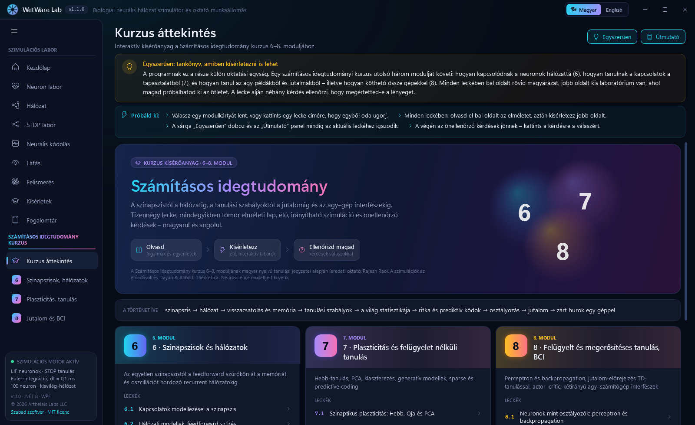
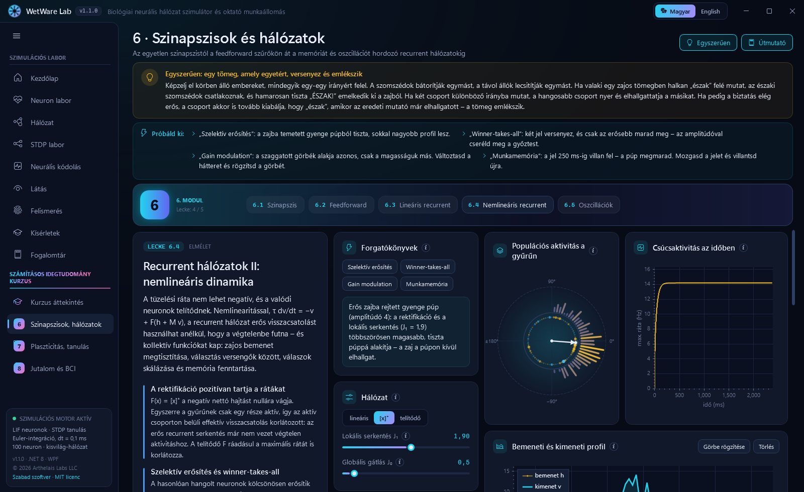
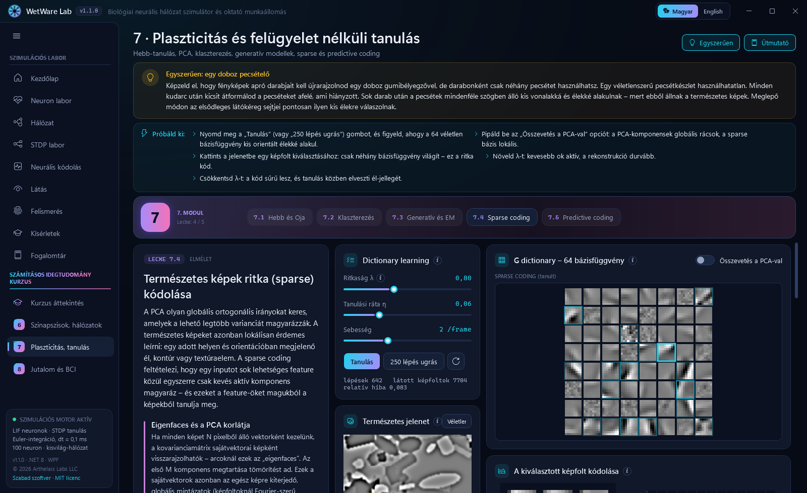
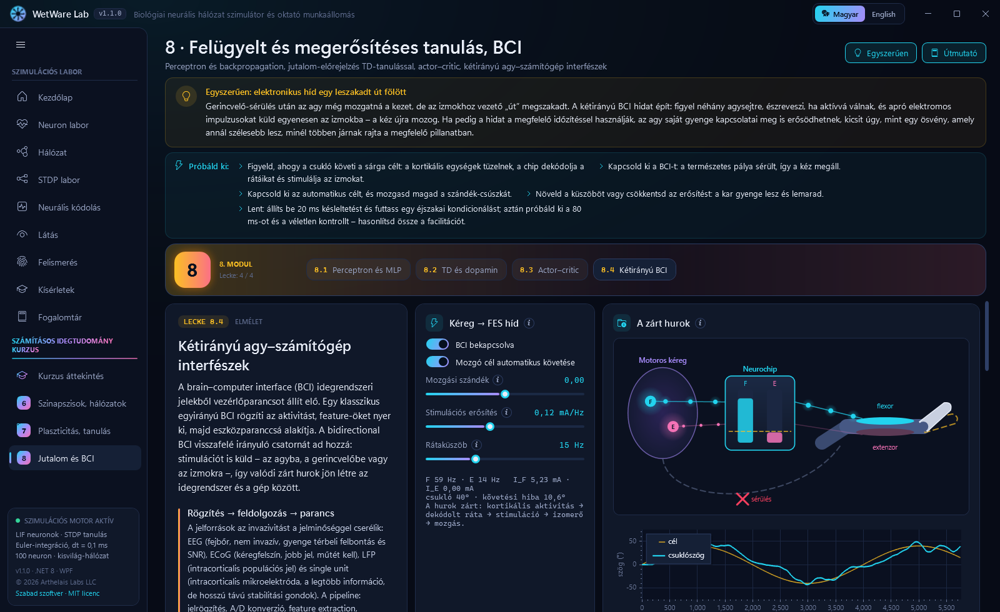

# WetWare Lab – biológiai neurális hálózat szimulátor és oktató munkaállomás

[English](README.md) · **Magyar**


**Szabadon használható és terjeszthető.** A WetWare Lab nyílt forráskódú, [MIT licenc](LICENSE) alatt: az app és a forráskódja ingyen használható, másolható, terjeszthető és módosítható – tanórán, saját projektben vagy akár kereskedelmi célra is. Csak a szerzői jogi és licencmegjegyzésnek kell megmaradnia.

📖 **Most ismerkedsz vele? Olvasd el a [Felhasználói útmutatót](docs/USER_GUIDE.hu.md)** ([English](docs/USER_GUIDE.md)) – oldalanként bemutatja, mit látsz a képernyőn, mit érdemes kipróbálni, és mit tanulhatsz belőle.

## Letöltés

A `WetWareLab.exe` a [legfrissebb kiadásból](https://github.com/SandsHUN/WetWareSimulation/releases/latest) tölthető le: egyetlen fájl, telepítés és .NET futtatókörnyezet nélkül fut (Windows 10/11, 64 bit). Mivel nincs digitálisan aláírva, első indításkor a SmartScreen figyelmeztethet: „További információ” → „Futtatás mindenképp”.

Modern, kétnyelvű (magyar / angol) WPF oktatóalkalmazás a biológiai számítás (wetware / neuromorf számítástechnika) szemléltetésére. A specifikáció: [Specifications/wetware_specifications.md](Specifications/wetware_specifications.md).

## Futtatás

```
dotnet run --project src/WetWare.App
dotnet test tests/WetWare.Core.Tests
```

Követelmény: Windows 10/11, .NET 8 SDK (vagy újabb). A `WetWare.slnx` megnyitásához Visual Studio 2022 17.13+ vagy .NET 9.0.200+ SDK kell.

### Önálló EXE készítése

Egyetlen, telepítés nélkül futtatható fájl (a .NET futtatókörnyezetet is tartalmazza, ~76 MB):

```
dotnet publish src/WetWare.App -c Release -r win-x64 --self-contained true -p:PublishSingleFile=true -p:IncludeNativeLibrariesForSelfExtract=true -p:EnableCompressionInSingleFile=true -o publish/win-x64
```

Eredmény: `publish/win-x64/WetWareLab.exe` – bármely 64 bites Windows 10/11 gépre átmásolható.

### Verziózás

A verzió formátuma `fő.al.build` (a címsorban és az oldalsávban látható). A `fő.al` részt a `src/WetWare.App/WetWare.App.csproj` `VersionBase` értéke adja; a build-szám a `src/WetWare.App/build.number` fájlban van, és minden buildnél automatikusan eggyel nő. A CI `-p:NoBuildIncrement=true` kapcsolóval fordít, így a kiadás pontosan a commitolt számot kapja.

## Modulok

| Oldal | Tartalom |
|---|---|
| Kezdőlap | Áttekintés, élő háttérhálózat, modulkártyák |
| Neuron labor | LIF neuron elektródával, oszcilloszkóp, élő egyenlet (hover-magyarázatokkal), fázissík, f–I görbe, lépésenkénti Bio-Debugger |
| Hálózat | 100 neuronos kisvilág-hálózat: raster plot, populációs ráta, hálózati gráf (kalcium-képalkotás-szerű felvillanások, terjedő tüskék), STDP súlymátrix, súlyeloszlás, metrikák (szinkronizációs index, átlagos tüzelés, erős szinapszisok), stimuláció- és lézeres abláció eszköz, matematikai labor, „Mi történik most?” narrátor |
| STDP labor | Bi & Poo párosítási protokoll, tanulási ablak, súlytörténet, animált pre/post idővonal |
| Neurális kódolás | Frekvencia-, latencia-, fázis- és populációs kód ugyanarra az ingerre |
| Látás | Retina (ON/OFF centrum–környék, DoG) → V1 (Gabor-orientáció), illúziók (Hermann-rács, Mach-sávok, szimultán kontraszt), rajzolás, képbetöltés, tüskeképzés |
| Felismerés | Felügyelet nélkül, STDP-vel tanuló tüskés WTA hálózat; kialakuló receptív mezők, animált felismerés |
| Kísérletek | Pavlovi kondicionálás, roham, homeosztázis, információkódolás |
| Fogalomtár | 38 kereshető fogalom, kétnyelvűen |

### Számításos idegtudomány kurzus – kísérőanyag

A menü külön szekciója a *Számításos idegtudomány* kurzus (oktató: Rajesh Rao) 6–8. modulját **14 interaktív leckévé** alakítja. Minden leckében elméleti panel (fogalmak, kulcsegyenletek, biológia, kapcsolat a gépi tanulással), élő labor, „Jegyezd meg” kártya és önellenőrző kérdések válaszokkal – mindkét nyelven.

| Modul | Leckék |
|---|---|
| **6 · Szinapszisok és hálózatok** | 6.1 vezetőképesség-alapú szinapszis (AMPA / GABA_A / NMDA / söntölő) és két csatolt neuron · 6.2 feedforward hálózat mint szűrő (v = Wu, élkiemelés) · 6.3 lineáris recurrent hálózat: sajátmódusok, 1/(1−λ) erősítés, okulomotoros integrátor · 6.4 nemlineáris gyűrűhálózat: szelektív erősítés, winner-takes-all, gain modulation, munkamemória · 6.5 E–I oszcillációk: fázissík, komplex sajátértékek, csillapított oszcilláció és határciklus |
| **7 · Plaszticitás és felügyelet nélküli tanulás** | 7.1 Hebb-, kovariancia- és Oja-szabály, amely megtalálja a főkomponenst · 7.2 competitive learning, K-means és önszerveződő térkép · 7.3 generatív modellek, Gauss-keverék és EM (soft assignment, Bayes a kurzornál, „álmodott” minták) · 7.4 természetes képek sparse kódolása – V1-szerű élszűrők kontra globális PCA-komponensek · 7.5 predictive coding: predikció ↓ / hiba ↑ inference-hurok |
| **8 · Felügyelt és megerősítéses tanulás, BCI** | 8.1 perceptron, XOR és backpropagationnel tanított MLP · 8.2 TD-tanulás és a dopamin jutalom-predikciós hibája · 8.3 actor–critic a „patkány a csűrben” példán · 8.4 kétirányú BCI: kéreg → FES híd és spike-triggered kondicionálás STDP-szerű ablakkal |

<table>
<tr><td></td><td></td></tr>
<tr><td></td><td></td></tr>
</table>

Minden oldalon: tooltipek, „Egyszerűen” (laikusoknak szóló hasonlatok) és „Útmutató” (javasolt kísérletek) panel; futás közbeni HU/EN nyelvváltás. Az app alapértelmezetten angolul indul; a jobb felső sarokban magyarra váltható, és a választást megjegyzi.

## Architektúra

- `src/WetWare.Core` – platformfüggetlen szimulációs mag (.NET 8): LIF neuron, kisvilág-hálózat késleltetett szinapszisokkal, nyomkövetéses STDP, Tsodyks–Markram rövid távú depresszió, Poisson-zaj, metrikák, forgatókönyvek, kódolás, látás, felismerés. A `Course/` mappa a kurzusleckék modelljeit tartalmazza (vezetőképesség-alapú szinapszis, rátahálózatok, Hebb / kompetitív / EM / sparse tanulás, perceptron és MLP, TD és actor–critic, BCI).
- `src/WetWare.App` – WPF kliens (MVVM, CommunityToolkit.Mvvm, ScottPlot 5, saját nagy teljesítményű vezérlők).
- `tests/WetWare.Core.Tests` – xUnit tesztek (analitikus tüzelési frekvencia, STDP, Pavlov-tanulás, roham-szinkronizáció, látás, felismerés).

**Eltérés a specifikációtól:** a Python/Brian 2 + ZeroMQ motor helyett az azonos egyenleteket egy beépített C# motor számolja (dt = 0,1 ms, Euler). Így az app telepítés nélkül, egyetlen programként fut; a képkockánkénti adatátadás (FrameClock) a PUB/SUB telemetria szerepét tölti be.

## Lokalizáció

A szövegek a `src/WetWare.App/Localization/Strings/hu.json` és `en.json` fájlokban vannak (azonos kulcsokkal); a kurzus szövegei a `Strings/Course/*.hu.json` / `*.en.json` fájlokban, amelyeket induláskor összefésül az app. XAML-ben: `{loc:Tr Kulcs}`.

## Fejlesztői kapcsolók

`WetWareLab.exe --lang en --page Network --scenario Pavlov --snapshot out.png --delay 5000` – képernyőkép készítése automatizált vizuális ellenőrzéshez. A `--train 900` előre betanítja a számjegy-felismerőt, és elindít egy felismerést. Oldalkulcsok: `Home`, `Neuron`, `Network`, `Stdp`, `Coding`, `Vision`, `Recognition`, `Scenarios`, `Glossary`, `Course`, `M6`, `M7`, `M8`; a `--page M7/3` a 7.4-es leckét nyitja meg (nullától számozott leckeindex).


## Hivatkozások

A modellek forrásait lásd az [angol README](README.md#references) végén.

## Licenc

A WetWare Lab szabad szoftver, [MIT licenc](LICENSE) alatt jelent meg. Szabadon:

- **használhatod** bármilyen célra – oktatás, kutatás, magán- vagy kereskedelmi felhasználás;
- **másolhatod és terjesztheted** az appot (`WetWareLab.exe`) és a forráskódot, pl. felteheted a tanterem minden gépére;
- **módosíthatod**, lefordíthatod, vagy saját projektet építhetsz a kódra.

Az egyetlen feltétel, hogy a szerzői jogi és licencmegjegyzés a szoftver példányaival együtt maradjon. A szoftver mindenféle garancia nélkül érhető el.

[MIT](LICENSE) © 2026 Arthelais Labs LLC
