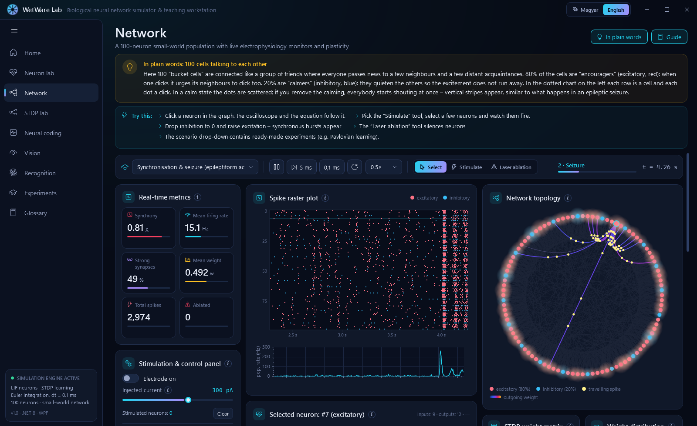
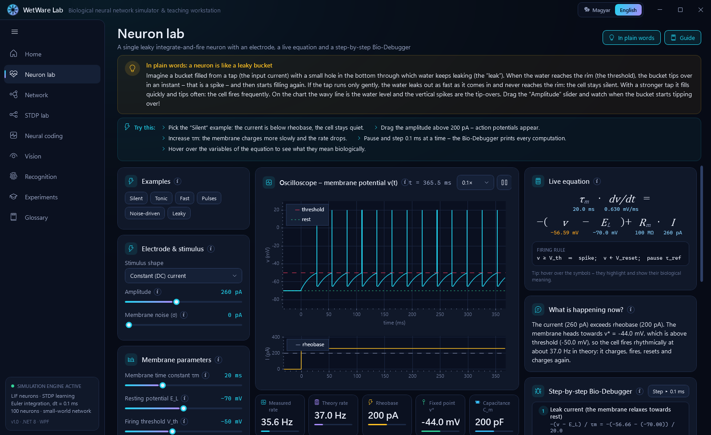
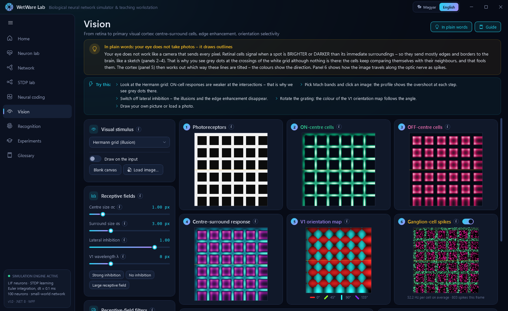
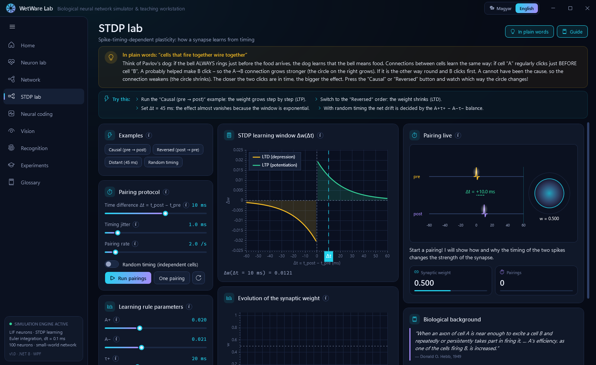
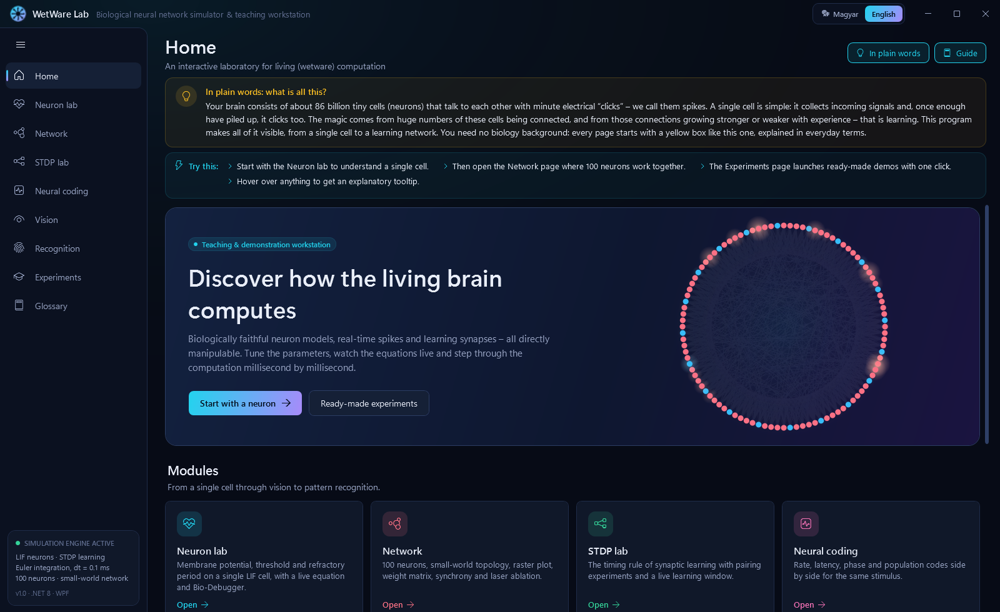

# WetWare Lab – biological neural network simulator & teaching workstation

**English** · [Magyar](README.hu.md)

[](https://github.com/SandsHUN/WetWereSimulation/actions/workflows/build.yml)
[](LICENSE)

An interactive, bilingual (English / Hungarian) Windows desktop app that makes **biological computation** visible – from a single leaky neuron, through a learning 100-neuron network, to a retina model and a spiking network that learns to recognise digits without a teacher.

It is built for teaching and demonstration: every control has a tooltip, every page starts with an **"In plain words"** explanation using everyday analogies (no biology background needed), and a **"Guide"** panel suggests experiments to try.



## Download

Grab `WetWareLab.exe` from the [latest release](https://github.com/SandsHUN/WetWereSimulation/releases/latest). It is a single self-contained file – no installation and no .NET runtime required (Windows 10/11, 64-bit).

> The executable is not code-signed, so Windows SmartScreen may warn on first launch: click **More info → Run anyway**.

## What's inside

| Page | What you can do |
|---|---|
| **Neuron lab** | Leaky integrate-and-fire neuron with an electrode, oscilloscope, a live equation (hover the symbols for their meaning), phase plane, f–I curve and a step-by-step "Bio-Debugger" |
| **Network** | 100-neuron small-world network (80% excitatory / 20% inhibitory): raster plot, population rate, animated graph, STDP weight matrix, weight histogram, synchrony metrics, stimulation and "laser ablation" tools, a live "What is happening now?" narrator |
| **STDP lab** | Bi & Poo pairing protocol, learning window, weight history, animated pre/post timeline |
| **Neural coding** | Rate, latency, phase and population codes side by side for the same stimulus |
| **Vision** | Retina (ON/OFF centre–surround, difference of Gaussians) → V1 (Gabor orientation energy); illusions (Hermann grid, Mach bands, simultaneous contrast); draw your own input or load a photo |
| **Recognition** | Unsupervised winner-take-all spiking network trained with STDP; watch receptive fields turn into digits |
| **Experiments** | Pavlovian conditioning, epileptiform seizure, homeostasis, information coding – one click each |
| **Glossary** | 38 searchable terms in both languages |

The language can be switched at any time while the app is running.

<table>
<tr><td></td><td></td></tr>
<tr><td></td><td></td></tr>
</table>

## Build from source

Requirements: Windows 10/11 and the [.NET 8 SDK](https://dotnet.microsoft.com/download) or newer.

```
dotnet run --project src/WetWare.App
dotnet test tests/WetWare.Core.Tests
```

Single-file, self-contained executable (~76 MB):

```
dotnet publish src/WetWare.App -c Release -r win-x64 --self-contained true -p:PublishSingleFile=true -p:IncludeNativeLibrariesForSelfExtract=true -p:EnableCompressionInSingleFile=true -o publish/win-x64
```

The solution file is `WetWare.slnx`, which needs Visual Studio 2022 17.13+ or the .NET 9.0.200+ SDK; the projects themselves target .NET 8.

## Architecture

- `src/WetWare.Core` – platform-independent simulation core (.NET 8, no UI dependencies): LIF neurons (explicit Euler, dt = 0.1 ms), Watts–Strogatz small-world network with delayed exponential current synapses, trace-based STDP, Tsodyks–Markram short-term depression, Poisson background noise, synchrony metrics, scenarios, neural coding, visual pathway and the spiking classifier.
- `src/WetWare.App` – WPF client (MVVM with CommunityToolkit.Mvvm, ScottPlot 5, custom `WriteableBitmap` renderers for the raster plot, graph and heatmaps). The simulation advances once per rendered frame.
- `tests/WetWare.Core.Tests` – xUnit tests that check the model against theory: analytic LIF firing rate, STDP window, Pavlovian learning, seizure synchronisation, vision filters, recognition accuracy.

The original design ([Specifications/wetware_specifications.md](Specifications/wetware_specifications.md)) called for a Python/Brian 2 engine talking to the UI over ZeroMQ. The same equations are implemented natively in C# instead, so the app runs as a single program with no Python installation.

### Localization

All UI text lives in `src/WetWare.App/Localization/Strings/en.json` and `hu.json` (identical keys). In XAML: `{loc:Tr Some.Key}`. Adding a language means adding one JSON file.

### Developer switches

```
WetWareLab.exe --lang en --page Network --scenario Seizure --snapshot out.png --delay 5000
```

Opens a page, optionally starts a scenario, saves a screenshot after the delay and exits – used for automated visual checks. Page keys: `Home`, `Neuron`, `Network`, `Stdp`, `Coding`, `Vision`, `Recognition`, `Scenarios`, `Glossary`.

## References

- Gerstner, Kistler, Naud & Paninski: *Neuronal Dynamics* (2014) – LIF model, neural coding
- Bi & Poo (1998), *J. Neurosci.* 18:10464 – spike-timing-dependent plasticity
- Song, Miller & Abbott (2000), *Nat. Neurosci.* 3:919 – trace-based STDP
- Tsodyks & Markram (1997), *PNAS* 94:719 – short-term synaptic depression
- Watts & Strogatz (1998), *Nature* 393:440 – small-world networks
- Golomb & Rinzel (1993), *Phys. Rev. E* 48:4810 – synchrony measure
- Brunel (2000), *J. Comput. Neurosci.* 8:183 – balanced E/I networks
- Diehl & Cook (2015), *Front. Comput. Neurosci.* 9:99 – unsupervised digit recognition with STDP
- Hubel & Wiesel (1962), *J. Physiol.* 160:106 – receptive fields in visual cortex

## Contributing

Bug reports, corrections to the science and new translations are welcome – please open an issue or a pull request.

## License

[MIT](LICENSE) © SandsHUN
