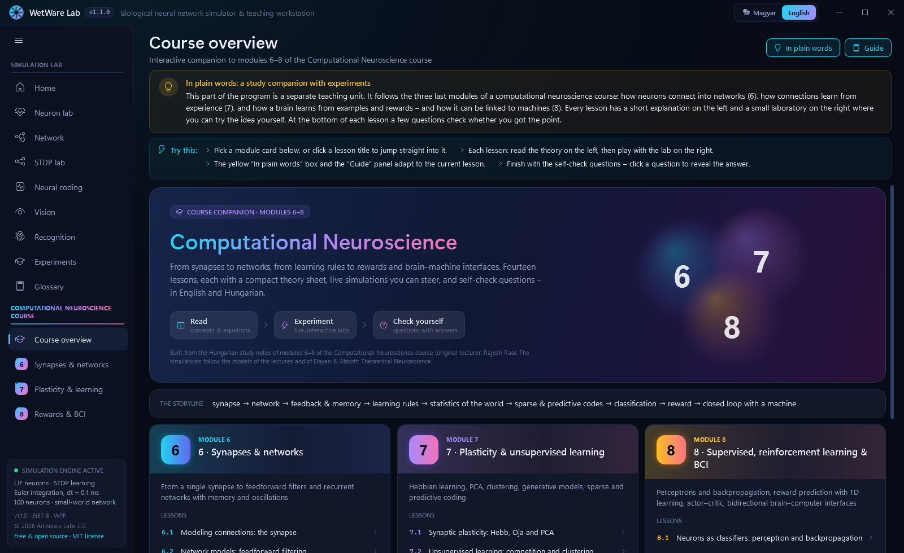
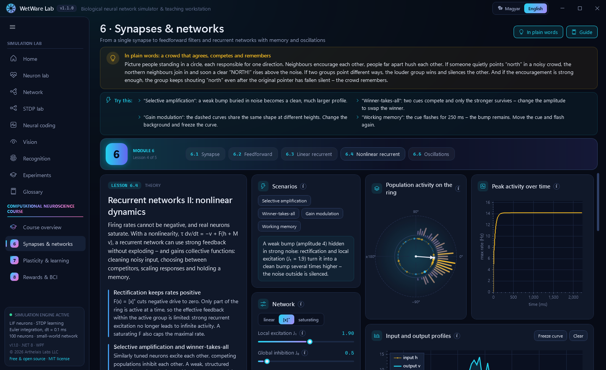
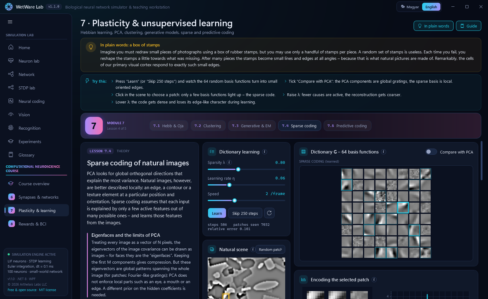
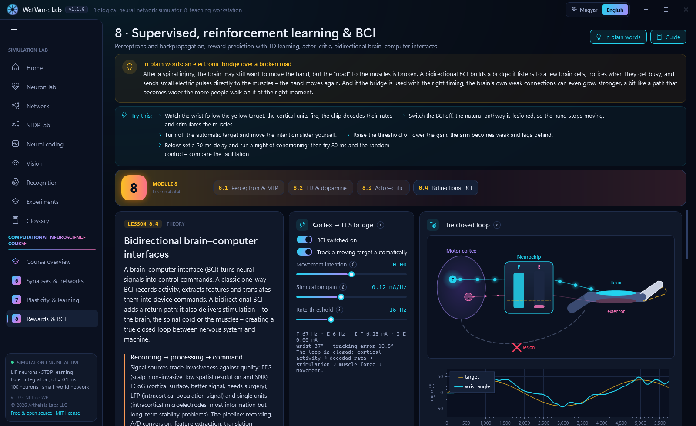

# WetWare Lab – biological neural network simulator & teaching workstation

**English** · [Magyar](README.hu.md)

[](https://github.com/SandsHUN/WetWareSimulation/actions/workflows/build.yml)
[](LICENSE)

An interactive, bilingual (English / Hungarian) Windows desktop app that makes **biological computation** visible – from a single leaky neuron, through a learning 100-neuron network, to a retina model and a spiking network that learns to recognise digits without a teacher.

It is built for teaching and demonstration: every control has a tooltip, every page starts with an **"In plain words"** explanation using everyday analogies (no biology background needed), and a **"Guide"** panel suggests experiments to try.


**Free to use and share.** WetWare Lab is open source under the [MIT license](LICENSE): you may use, copy, distribute and modify both the app and its source code free of charge – in classrooms, in your own projects or commercially. Just keep the copyright and license notice.

📖 **New here? Read the [User Guide](docs/USER_GUIDE.md)** ([magyarul](docs/USER_GUIDE.hu.md)) – a page-by-page tour of what you see on screen, what to try and what it teaches.

## Download

Grab `WetWareLab.exe` from the [latest release](https://github.com/SandsHUN/WetWareSimulation/releases/latest). It is a single self-contained file – no installation and no .NET runtime required (Windows 10/11, 64-bit).

> The executable is not code-signed, so Windows SmartScreen may warn on first launch: click **More info → Run anyway**.

## What's inside

| Page | What you can do |
|---|---|
| **Neuron lab** | Leaky integrate-and-fire neuron with an electrode, oscilloscope, a live equation (hover the symbols for their meaning), phase plane, f–I curve and a step-by-step "Bio-Debugger" |
| **Network** | 100-neuron small-world network (80% excitatory / 20% inhibitory): raster plot, population rate, animated graph, STDP weight matrix, weight histogram, synchrony metrics, stimulation and "laser ablation" tools, a live "What is happening now?" narrator |
| **STDP lab** | Bi & Poo pairing protocol, learning window, weight history, animated pre/post timeline |
| **Neural coding** | Rate, latency, phase and population codes side by side for the same stimulus |
| **Vision** | Retina (ON/OFF centre–surround, difference of Gaussians) → V1 (Gabor orientation energy); illusions (Hermann grid, Mach bands, simultaneous contrast); draw your own input or load a photo |
| **Recognition** | Unsupervised winner-take-all spiking network trained with STDP; watch receptive fields turn into digits |
| **Experiments** | Pavlovian conditioning, epileptiform seizure, homeostasis, information coding – one click each |
| **Glossary** | 38 searchable terms in both languages |

The app starts in English; switch to Hungarian (and back) at any time with the toggle in the top-right corner – the choice is remembered.

### Computational Neuroscience course companion

A separate section of the menu turns modules 6–8 of the *Computational Neuroscience* course (lecturer: Rajesh Rao) into **14 interactive lessons**. Every lesson has a theory panel (concepts, key equations, biology, link to machine learning), a live lab, a "Remember" card and self-check questions with answers – in both languages.

| Module | Lessons |
|---|---|
| **6 · Synapses & networks** | 6.1 conductance synapses (AMPA / GABA_A / NMDA / shunting) and two coupled neurons · 6.2 feedforward networks as filters (v = Wu, edge detection) · 6.3 linear recurrent networks: eigenmodes, 1/(1−λ) amplification, the oculomotor integrator · 6.4 nonlinear ring network: selective amplification, winner-takes-all, gain modulation, working memory · 6.5 E–I oscillations: phase plane, complex eigenvalues, damped oscillation vs limit cycle |
| **7 · Plasticity & unsupervised learning** | 7.1 Hebb, covariance and Oja rules finding the principal component · 7.2 competitive learning, K-means and self-organizing maps · 7.3 generative models, Gaussian mixtures and EM (soft assignment, Bayes at the cursor, "dreamed" samples) · 7.4 sparse coding of natural images – V1-like edge features vs global PCA components · 7.5 predictive coding: prediction ↓ / error ↑ inference loop |
| **8 · Supervised, reinforcement learning & BCI** | 8.1 perceptron, XOR and a backprop-trained MLP · 8.2 TD learning and the dopamine reward-prediction error · 8.3 actor–critic in the "rat in a barn" · 8.4 bidirectional BCI: cortex → FES bridge and spike-triggered conditioning with an STDP-like window |

<table>
<tr><td></td><td></td></tr>
<tr><td></td><td></td></tr>
</table>

<table>
<tr><td></td><td></td></tr>
<tr><td></td><td></td></tr>
</table>

## Build from source

Requirements: Windows 10/11 and the [.NET 8 SDK](https://dotnet.microsoft.com/download) or newer.

```
dotnet run --project src/WetWare.App
dotnet test tests/WetWare.Core.Tests
```

Single-file, self-contained executable (~76 MB):

```
dotnet publish src/WetWare.App -c Release -r win-x64 --self-contained true -p:PublishSingleFile=true -p:IncludeNativeLibrariesForSelfExtract=true -p:EnableCompressionInSingleFile=true -o publish/win-x64
```

### Versioning

The version is `major.minor.build` (shown in the title bar and the sidebar). `major.minor` is set by `VersionBase` in `src/WetWare.App/WetWare.App.csproj`; the build number lives in `src/WetWare.App/build.number` and is incremented automatically on every build. CI builds pass `-p:NoBuildIncrement=true`, so a release carries exactly the committed number.

The solution file is `WetWare.slnx`, which needs Visual Studio 2022 17.13+ or the .NET 9.0.200+ SDK; the projects themselves target .NET 8.

## Architecture

- `src/WetWare.Core` – platform-independent simulation core (.NET 8, no UI dependencies): LIF neurons (explicit Euler, dt = 0.1 ms), Watts–Strogatz small-world network with delayed exponential current synapses, trace-based STDP, Tsodyks–Markram short-term depression, Poisson background noise, synchrony metrics, scenarios, neural coding, visual pathway and the spiking classifier. `Course/` holds the models of the course lessons (conductance synapses, rate networks, Hebbian / competitive / EM / sparse learning, perceptron and MLP, TD and actor–critic, BCI).
- `src/WetWare.App` – WPF client (MVVM with CommunityToolkit.Mvvm, ScottPlot 5, custom `WriteableBitmap` renderers for the raster plot, graph and heatmaps). The simulation advances once per rendered frame.
- `tests/WetWare.Core.Tests` – xUnit tests that check the model against theory: analytic LIF firing rate, STDP window, Pavlovian learning, seizure synchronisation, vision filters, recognition accuracy.

The original design ([Specifications/wetware_specifications.md](Specifications/wetware_specifications.md)) called for a Python/Brian 2 engine talking to the UI over ZeroMQ. The same equations are implemented natively in C# instead, so the app runs as a single program with no Python installation.

### Localization

All UI text lives in `src/WetWare.App/Localization/Strings/en.json` and `hu.json` (identical keys); the course texts are in `Strings/Course/*.en.json` / `*.hu.json` and are merged at start-up. In XAML: `{loc:Tr Some.Key}`. A course lesson's theory panel is built from its keys (`M7.Sparse.Title`, `.Lead`, `.C1.Title` / `.C1.Text`, `.Formulas`, `.Q1` / `.A1`, …). Adding a language means adding one JSON file.

### Developer switches

```
WetWareLab.exe --lang en --page Network --scenario Seizure --snapshot out.png --delay 5000
```

`--train 900` pre-trains the digit classifier and starts recognising a digit. The command opens a page, optionally starts a scenario, saves a screenshot after the delay and exits – used for automated visual checks. Page keys: `Home`, `Neuron`, `Network`, `Stdp`, `Coding`, `Vision`, `Recognition`, `Scenarios`, `Glossary`, `Course`, `M6`, `M7`, `M8`; `--page M7/3` opens lesson 7.4 (zero-based lesson index).

## References

- Gerstner, Kistler, Naud & Paninski: *Neuronal Dynamics* (2014) – LIF model, neural coding
- Bi & Poo (1998), *J. Neurosci.* 18:10464 – spike-timing-dependent plasticity
- Song, Miller & Abbott (2000), *Nat. Neurosci.* 3:919 – trace-based STDP
- Tsodyks & Markram (1997), *PNAS* 94:719 – short-term synaptic depression
- Watts & Strogatz (1998), *Nature* 393:440 – small-world networks
- Golomb & Rinzel (1993), *Phys. Rev. E* 48:4810 – synchrony measure
- Brunel (2000), *J. Comput. Neurosci.* 8:183 – balanced E/I networks
- Diehl & Cook (2015), *Front. Comput. Neurosci.* 9:99 – unsupervised digit recognition with STDP
- Hubel & Wiesel (1962), *J. Physiol.* 160:106 – receptive fields in visual cortex
- Dayan & Abbott: *Theoretical Neuroscience* (2001) – synapses, rate networks, plasticity, reinforcement learning (course lessons)
- Oja (1982), *J. Math. Biol.* 15:267 – a simplified neuron model as a principal component analyzer
- Olshausen & Field (1996), *Nature* 381:607 – sparse coding of natural images
- Rao & Ballard (1999), *Nat. Neurosci.* 2:79 – predictive coding in the visual cortex
- Schultz, Dayan & Montague (1997), *Science* 275:1593 – dopamine and reward prediction error
- Jackson, Mavoori & Fetz (2006), *Nature* 444:56 – motor cortex plasticity induced by an electronic neural implant
- Moritz, Perlmutter & Fetz (2008), *Nature* 456:639 – direct control of paralysed muscles by cortical neurons

## Contributing

Bug reports, corrections to the science and new translations are welcome – please open an issue or a pull request.

## License

WetWare Lab is free software, released under the [MIT license](LICENSE). You are free to:

- **use** it for any purpose – teaching, research, personal or commercial;
- **copy and distribute** the app (`WetWareLab.exe`) and the source code, e.g. install it on every classroom PC;
- **modify** it, translate it or build your own projects on the code.

The only condition is that the copyright and license notice stays with copies of the software. It comes without any warranty.

[MIT](LICENSE) © 2026 Arthelais Labs LLC
