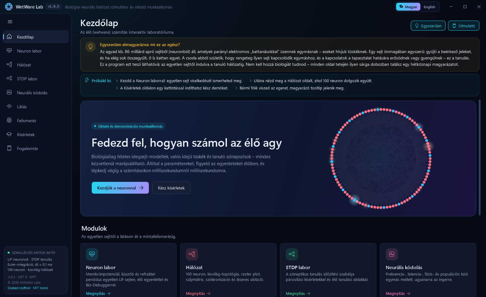
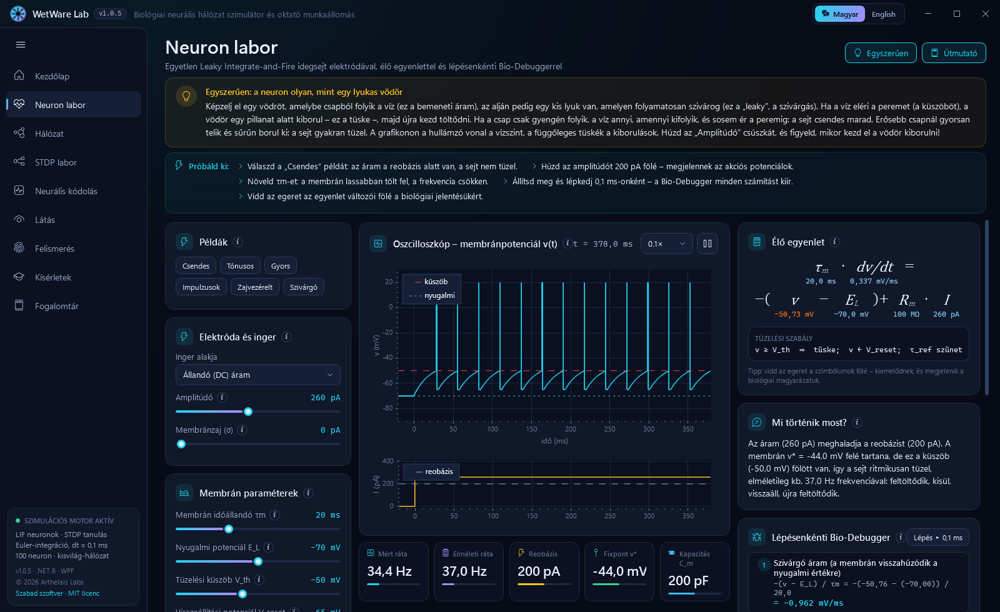
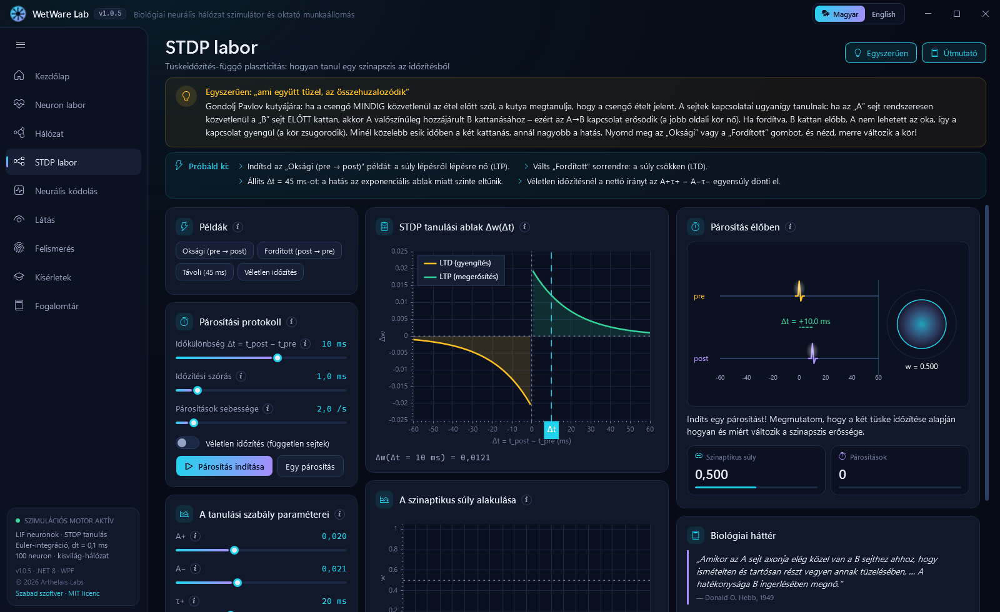
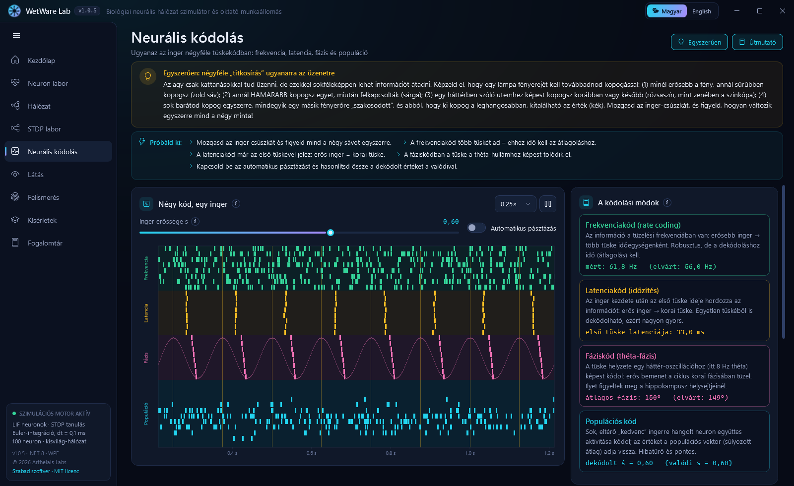
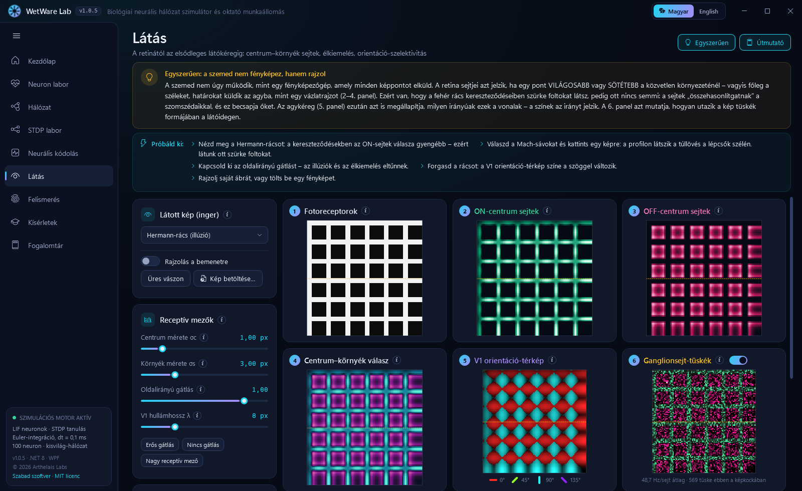
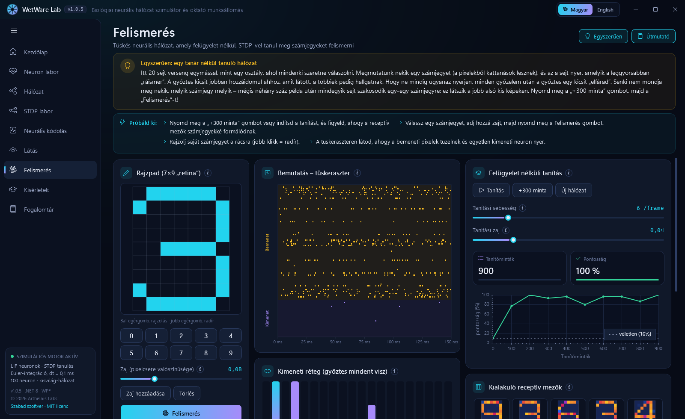
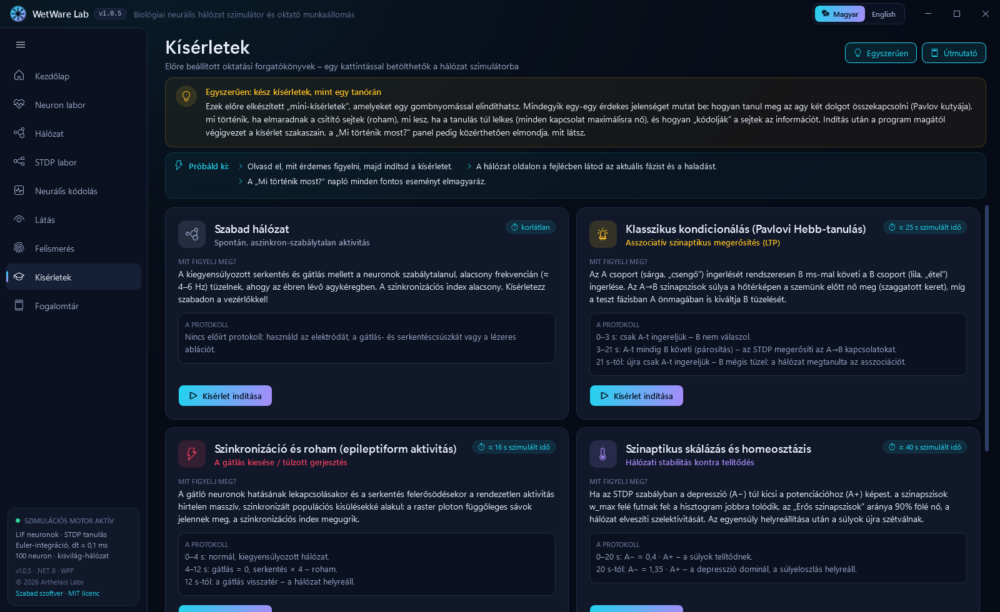
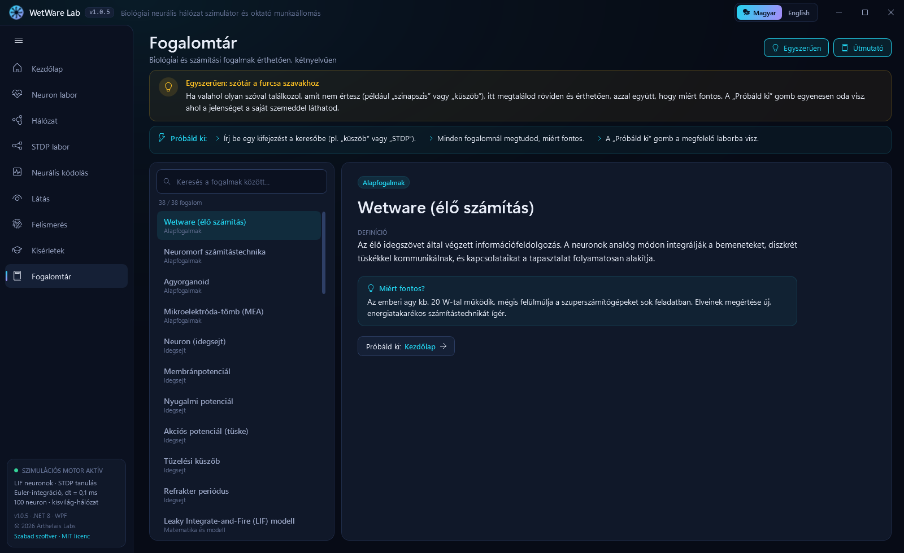

# WetWare Lab – Felhasználói útmutató

[English](USER_GUIDE.md) · **Magyar** · [Vissza a README-hez](../README.hu.md)

Ez az útmutató végigvezet a WetWare Lab minden oldalán: mit látsz a képernyőn, mit érdemes kipróbálni, és mit tanulhatsz belőle az agy működéséről. Biológiai előismeret nem kell. Minden fejezet azzal a hétköznapi magyarázattal kezdődik, amely az appban a sárga **„Egyszerűen”** dobozban is olvasható.

A képernyőképek a magyar felületet mutatják. Az app alapértelmezetten angolul indul; a címsorban a **Magyar** gombbal válthatsz át.

A WetWare Lab szabad szoftver, [MIT licenc](../LICENSE) alatt. A program és a forráskódja is ingyen használható, másolható, továbbadható és módosítható, akár saját projektben vagy kereskedelmi célra is. Az egyetlen feltétel, hogy a szerzői jogi és licencmegjegyzés megmaradjon.

## Tartalom

- [Első lépések](#első-lépések)
- [Kezdőlap](#kezdőlap)
- [Neuron labor](#neuron-labor)
- [Hálózat](#hálózat)
- [STDP labor](#stdp-labor)
- [Neurális kódolás](#neurális-kódolás)
- [Látás](#látás)
- [Felismerés](#felismerés)
- [Kísérletek](#kísérletek)
- [Fogalomtár](#fogalomtár)
- [Tippek tanároknak](#tippek-tanároknak)

---

## Első lépések

1. Töltsd le a `WetWareLab.exe`-t a [legfrissebb kiadásból](https://github.com/SandsHUN/WetWareSimulation/releases/latest), és indítsd el. Telepíteni nem kell. Ha a Windows SmartScreen figyelmeztet, kattints a **További információ → Futtatás mindenképp** gombra (a fájl nincs digitálisan aláírva).
2. Az app angolul indul. A címsorban a **Magyar / English** kapcsolóval bármikor nyelvet válthatsz, és a választást megjegyzi.
3. A bal oldali menüben válaszd ki az oldalt. A **☰** gombbal a menü ikonsávvá csukható.

**Beépített segítség minden oldalon**

| Elem | Mire való? |
|---|---|
| **Egyszerűen** (sárga doboz, fent) | Hétköznapi hasonlattal, szakszavak nélkül magyarázza el az oldalt. A jobb felső *Egyszerűen* gombbal kapcsolható ki és be. |
| **Útmutató / Próbáld ki** (kék doboz) | Lépésenként javasolt kísérletek. Az *Útmutató* gombbal kapcsolható. |
| **ⓘ ikonok és tooltipek** | Bármelyik vezérlő, grafikon, változó vagy szám fölé víve az egeret magyarázat jelenik meg. |
| **Mi történik most?** | Élő narrátor a Neuron labor és a Hálózat oldalon: szövegesen elmondja, mi történik (miért tüzelt egy neuron, miért erősödött egy szinapszis…). |

A bal oldali menü alján látható a használt modell, a verziószám, a készítő és a licenc. A licencsorra kattintva a GitHubon megnyílik a forráskód.

---

## Kezdőlap

> **Egyszerűen:** az agyad kb. 86 milliárd apró sejtből (neuronból) áll, amelyek parányi elektromos „kattanásokkal” üzennek egymásnak; ezeket hívjuk tüskéknek. Egy sejt önmagában egyszerű: gyűjti a beérkező jeleket, és ha elég sok összegyűlt, ő is kattan egyet. A csoda abból születik, hogy rengeteg ilyen sejt kapcsolódik egymáshoz, és a kapcsolatok a tapasztalat hatására erősödnek vagy gyengülnek. Ez a tanulás.

**Mit látsz?**
- A jobb oldali **animált gyűrű** egy háttérben élőben futó, 100 neuronos hálózat. Minden felvillanás egy tüske.
- A **modulkártyák** bemutatják az egyes oldalakat. A kártyán a *Megnyitás* gombbal oda is lehet ugrani.
- A **Mi a wetware?**, a **Hogyan használd?** és **A modell** röviden elmagyarázza a hátteret és a modell pontos paramétereit.

**Javasolt sorrend:** Neuron labor → Hálózat → STDP labor → Kísérletek. Utána a Látás, a Felismerés és a Neurális kódolás tetszőleges sorrendben jöhet.

---

## Neuron labor

> **Egyszerűen:** a neuron olyan, mint egy lyukas vödör. Egy csap tölti (ez a bemenő áram), az alján lévő kis lyukon pedig folyamatosan szivárog ki a víz. Amikor a víz eléri a peremet (a küszöböt), a vödör egy pillanat alatt kiborul (ez a tüske), aztán újra telni kezd. Gyenge csappal soha nem telik meg, erős csappal gyakran borul.

**Mit látsz?**
- **Példák:** egykattintásos bemutatók. *Csendes* (küszöb alatti áram), *Tónusos* (szabályos tüzelés), *Gyors*, *Impulzusok*, *Zajvezérelt* és *Szivárgó*.
- **Elektróda és inger:** virtuális elektróda, amely áramot juttat a sejtbe. Választható az inger alakja (állandó, lépcső, impulzusok, rámpa, szinusz, zajos), az erőssége és a membránzaj.
- **Membrán paraméterek:** a modell állandói, például a τm időállandó, a nyugalmi potenciál, a küszöb és a visszaállási érték.
- **Oszcilloszkóp:** a membránfeszültség az idő függvényében (fent) és a beadott áram (lent). A piros szaggatott vonal a küszöb, a zöld pontozott a nyugalmi potenciál.
- **Élő egyenlet:** a szivárgó integráló-tüzelő (LIF) egyenlet, minden jel alatt az aktuális értékkel. A jelek fölé víve az egeret megjelenik a biológiai jelentésük.
- **Mi történik most?:** szövegesen elmagyarázza, miért hallgat vagy tüzel a sejt.
- **Lépésenkénti Bio-Debugger:** megállítás után 0,1 ms-onként léptethető, és minden számítást kiír (szivárgás, bemenet, integrálási lépés, küszöbellenőrzés).
- **Fázissík** és **f–I görbe** (lejjebb görgetve): hogyan változik a feszültség az egyes feszültségszinteken, és hogyan függ a tüzelési frekvencia a bemenő áramtól.
- **Mérőcsempék:** mért és elméleti tüzelési frekvencia, reobázis (a legkisebb áram, amelytől a sejt tüzelni kezd), fixpont, kapacitás.

**Próbáld ki!**
1. Kattints a *Csendes* példára. Az áram a reobázis (200 pA) alatt van, ezért a feszültség a küszöb alatt megáll, és nem történik semmi.
2. Húzd az amplitúdót 200 pA fölé. Megjelennek a tüskék, és a mért frekvencia megegyezik az elméletivel.
3. Növeld a τm értékét. A membrán lassabban töltődik, a tüzelés ritkul.
4. Kattints a *Zajvezérelt* példára. Az átlagos áram még mindig kevés lenne, a zaj mégis véletlen tüskéket vált ki.
5. Nyomd meg a szünet gombot, majd léptess a Bio-Debuggerrel, és kövesd lépésről lépésre a számolást.

**Mit tanulsz belőle?** A neuron összegzi a bemenetét, van egy küszöbe, és minden tüske után rövid pihenőre (refrakter periódusra) van szüksége. Az f–I görbe a mesterséges neurális hálózatok „aktivációs függvényének” biológiai őse.

---

## Hálózat

> **Egyszerűen:** itt 100 „vödör-sejt” van összekötve, mint egy baráti társaság, ahol mindenki néhány szomszédjának és pár távoli ismerősének adja tovább a híreket. A sejtek 80%-a „lelkesítő” (serkentő, piros), 20%-a „csitító” (gátló, kék). Nyugodt állapotban a pöttyök szétszórtak. Ha leveszed a csitítást, mindenki egyszerre kezd kiabálni. Ez történik egy epilepsziás rohamban is.

**Mit látsz?**
- **Eszköztár:** forgatókönyv-választó, szünet, *5 ms* léptetés, szimulációs sebesség, és a gráfra kattintás eszközei (*Kijelölés*, *Stimuláció*, *Lézeres abláció*). Kísérlet közben az aktuális fázist és a haladást is mutatja.
- **Valós idejű metrikák:**
  - *Szinkronizáció* χ: kb. 0,1–0,2 az egészséges, aszinkron állapot; 0,4 fölött a hálózat együtt tüzel, mint egy rohamban.
  - *Átlagos tüzelés*, *Erős szinapszisok*, *Átlagos súly*, *Összes tüske*, *Elpusztított*.
- **Spike raster plot:** minden sor egy neuron, minden pötty egy tüske. A függőleges csíkok azt jelentik, hogy a neuronok egyszerre tüzelnek. Alatta a populációs tüzelési ráta látható. Egy sorra kattintva kijelölheted az adott neuront.
- **Hálózati topológia:** a neuronok egy gyűrűn. A rövid ívek a szomszédokat kötik össze, a hosszú húrok véletlen „rövidítések”. A tüzelő sejtek felvillannak, a sárga pöttyök pedig a kijelölt neuron kapcsolatain haladó tüskék.
- **Ingerlő és vezérlő pult:** elektródaáram, a gátlás és a serkentés erőssége, háttérzaj, az STDP tanulás be- és kikapcsolása, tanulási ráta, LTD/LTP arány.
- **Kijelölt neuron:** a kiválasztott sejt oszcilloszkópja.
- **STDP súlymátrix** (hőtérkép) és **Súlyeloszlás** (hisztogram): mennyire erős az egyes kapcsolat, és hogyan oszlanak el az erősségek.
- **Interaktív matematikai és elméleti labor:** fülek az élő képletekkel, a valódi eseményeket mutató STDP tanulási görbével, a fázistérrel és a Bio-Debuggerrel.
- **Mi történik most?:** folyamatos napló, amely minden eseményt elmagyaráz. Például: *„Mivel a 12-es neuron 4 ms-mal a 31-es előtt tüzelt, a szinapszis +0,008-cal erősödött (LTP).”*

**Próbáld ki!**
1. Kattints egy neuronra a gráfon. Az oszcilloszkóp és az egyenletek ezt a neuront fogják mutatni.
2. Válaszd a *Stimuláció* eszközt, kattints néhány neuronra, kapcsold be az elektródát, és nézd, ahogy tüzelnek.
3. Vedd le a *Gátlás erősségét* 0-ra, és emeld a *Serkentés erősségét*. Megjelennek a függőleges csíkok, és χ felugrik.
4. A *Lézeres abláció* eszközzel kapcsolj ki egy neuroncsoportot, és figyeld, hogyan működik tovább a hálózat többi része.
5. A forgatókönyv-listából töltsd be a *Szinkronizáció és roham* kísérletet, és hagyd végigfutni a három fázisán.

**Mit tanulsz belőle?** Az agy működéséhez a serkentés és a gátlás egyensúlya kell. Ha a gátlás kiesik, szinkron, rohamszerű aktivitás alakul ki. Ezért hat sok epilepszia elleni gyógyszer úgy, hogy erősíti a gátlást.

---

## STDP labor

> **Egyszerűen:** „ami együtt tüzel, az összehuzalozódik”. Gondolj Pavlov kutyájára: ha a csengő mindig közvetlenül az étel előtt szól, a kutya megtanulja, hogy a csengő ételt jelent. A sejtek közötti kapcsolatok is így tanulnak. Ha az A sejt rendszeresen közvetlenül a B előtt tüzel, az A→B kapcsolat erősödik. Fordított sorrendnél gyengül.

**Mit látsz?**
- **Példák:** *Oksági (pre → post)*, *Fordított (post → pre)*, *Távoli (45 ms)* és *Véletlen időzítés*.
- **Párosítási protokoll:** a két tüske közötti időkülönbség (Δt), időzítési szórás, párosítási ütem, valamint gombok a folyamatos vagy egyenkénti párosításhoz. A klasszikus Bi és Poo (1998) kísérletet követi.
- **A tanulási szabály paraméterei:** A+, A−, τ+ és τ−, a tanulási ablak alakját meghatározó négy szám.
- **STDP tanulási ablak:** mennyit változik a súly a Δt függvényében. A zöld ág az erősítés (LTP), a sárga a gyengítés (LTD). Minden lezajlott párosítás pöttyként jelenik meg.
- **A szinaptikus súly alakulása:** a súly az egyes párosítások után.
- **Párosítás élőben:** a két tüske animációja. A jobb oldali kör maga a szinapszis, a mérete a súlyt követi.
- **Biológiai háttér:** az NMDA-receptor szerepe és Hebb eredeti, 1949-es idézete.

**Próbáld ki!**
1. Indítsd el az *Oksági* példát. A súly lépésről lépésre nő.
2. Válts a *Fordított* példára. A súly csökken.
3. Állítsd a Δt-t 45 ms-ra. Szinte semmi nem történik, mert a tanulási ablak az idővel exponenciálisan elhalványul.
4. Próbáld ki a *Véletlen időzítést*. Az összhatás iránya attól függ, hogy az ablak A+ vagy A− oldala a nagyobb.

**Mit tanulsz belőle?** A tüskék ezredmásodperc pontosságú időzítése dönti el, hogy egy kapcsolat erősödik vagy gyengül. Ez a tanulás és az emlékezés egyik fő mechanizmusa.

---

## Neurális kódolás

> **Egyszerűen:** az agy csak kattanásokkal tud üzenni, de ezekkel sokféleképpen lehet információt átadni. Képzeld el, hogy egy lámpa fényerejét kell továbbadnod kopogással: (1) minél erősebb a fény, annál sűrűbben kopogsz; (2) minél erősebb, annál hamarabb kopogsz egyet a felkapcsolás után; (3) egy háttérben szóló ütemhez képest korábban vagy később kopogsz; (4) sok barátod kopog egyszerre, mindegyik egy másik fényerőre „szakosodott”.

**Mit látsz?**
- **Inger erőssége s** csúszka (0–1) és *Automatikus pásztázás*, amely lassan föl-le mozgatja az ingert.
- **Négy kód, egy inger:** négy sáv mutatja ugyanazt az értéket négyféle kódolásban:
  - *Frekvencia* (zöld): erősebb ingerre több tüske.
  - *Latencia* (sárga): erősebb ingerre korábbi első tüske.
  - *Fázis* (rózsaszín): a tüske helye egy 8 Hz-es háttérhullámon belül.
  - *Populáció* (kék): 12 neuron, mindegyik más értéket „kedvel”.
- **A kódolási módok:** minden kódhoz egy kártya élő kiolvasással, például a mért és az elvárt frekvencia, vagy a visszafejtett és a valódi érték.
- **Hangolási görbék és populációs válasz:** hogyan reagál a 12 populációs neuron, és hogyan fejthető vissza belőlük az érték.
- **Összehasonlító táblázat:** sebesség, zajtűrés, energiaköltség, és hogy hol fordul elő az egyes kód az agyban.

**Próbáld ki!**
1. Mozgasd lassan a csúszkát, és figyeld, ahogy mind a négy sáv egyszerre változik.
2. Vedd észre, hogy a latenciakód egyetlen tüskével válaszol, a frekvenciakódnak viszont idő kell a tüskék megszámolásához.
3. Kapcsold be az *Automatikus pásztázást*, és hasonlítsd össze a populációból visszafejtett értéket a valódival.

---

## Látás

> **Egyszerűen:** a szemed nem fényképez, hanem körvonalakat rajzol. A retina sejtjei azt jelzik, ha egy pont világosabb vagy sötétebb a környezeténél, így főként éleket küldenek az agynak, mint egy vázlatot. Ezért látsz szürke pöttyöket egy fehér rács kereszteződéseiben, pedig ott nincs semmi.

**Mit látsz?** Hat számozott panel követi a látópályát:
1. **Fotoreceptorok:** a bemeneti kép. Kattintással áthelyezheted a profilvonalat, rajzolás módban rajzolhatsz is rá.
2. **ON-centrum sejtek:** ott tüzelnek, ahol a középpont világosabb a környezeténél.
3. **OFF-centrum sejtek:** ott tüzelnek, ahol sötétebb.
4. **Centrum–környék válasz:** csak az élek maradnak meg, az egyenletes területek eltűnnek.
5. **V1 orientáció-térkép:** az elsődleges látókéreg. A szín az egyes élek irányát mutatja (0°, 45°, 90°, 135°).
6. **Ganglionsejt-tüskék:** így halad a kép tüskék formájában a látóidegen.

Bal oldalon a **Látott kép (inger)** választó található. Benne vannak az illúziók (*Hermann-rács*, *Mach-sávok*, *Szimultán kontraszt*), valamint rácsok, egy arc és egy zajos négyzet. Rajzolhatsz is a bemenetre, vagy betölthetsz saját fényképet. Lejjebb vannak a **receptív mező** csúszkák és előbeállítások (*Erős gátlás*, *Nincs gátlás*, *Nagy receptív mező*), a **szűrőmagok** és az **intenzitásprofil**.

**Próbáld ki!**
1. Nézd meg a *Hermann-rácsot*. A 2-es panelen a kereszteződésekben gyengébb a válasz: innen jönnek a szürke pöttyök.
2. Válaszd a *Mach-sávokat*, és kattints a képre. A profilon minden lépcsőnél kis túllövés látszik.
3. Nyomd meg a *Nincs gátlás* gombot. Eltűnnek az illúziók és az élkiemelés.
4. Válaszd az *Orientált vonalat*, és forgasd el. A V1 térkép színe követi a szöget.
5. Tölts be egy saját fényképet, és nézd meg, mit küld belőle a retina az agynak.

**Mit tanulsz belőle?** A látás már a szemben számítással kezdődik. A retina kontraszttá tömöríti a képet, a V1 pedig felismeri az élek irányát (Hubel és Wiesel, Nobel-díj, 1981).

---

## Felismerés

> **Egyszerűen:** egy hálózat, amely tanár nélkül tanul. 20 sejt versenyez egymással, mint egy osztály, ahol mindenki felelni akar. Aki egy számjegyet a leggyorsabban „felismer”, az nyer, és kicsit jobban hozzáidomul. Senki nem mondja meg nekik, melyik szám melyik, mégis néhány száz példa után mindegyik sejt egy-egy számjegyre szakosodik.

**Mit látsz?**
- **Rajzpad (7×9 „retina”):** minden négyzet egy bemeneti neuron. Bal egérgombbal rajzolsz, jobbal radírozol. Alatta a 0–9 számjegyminták, a zaj-csúszka, a *Zaj hozzáadása*, a *Törlés* és a *Felismerés* gomb.
- **Felügyelet nélküli tanítás:** *Tanítás* (folyamatos), *+300 minta* (azonnali), *Új hálózat*, tanítási sebesség és zaj. Mellettük a *Tanítóminták* és a *Pontosság* számlálója és a pontossági görbe. Találomra tippelve 10% lenne a pontosság.
- **Bemutatás – tüskeraszter:** a bemeneti pixelek tüzelése (sárga) és a versengő kimeneti neuronok (lila).
- **Kimeneti réteg (győztes mindent visz):** a 20 kimeneti neuron tüskeszáma, mindegyik alatt az általa megtanult számjegy.
- **Kialakuló receptív mezők:** minden kimeneti neuron megtanult mintája kis képként. A véletlen zajból lassan számjegyek formálódnak.
- **Eredmény** és **Hogyan működik?**: a felismert számjegy a biztonsággal együtt, és az ötlépéses magyarázat (kódolás, összegzés, verseny, tanulás, homeosztázis).

**Próbáld ki!**
1. Nyomd meg kétszer-háromszor a *+300 minta* gombot, és figyeld, ahogy a receptív mezők számjegyekké formálódnak, és nő a pontosság.
2. Kattints egy számjegyre, nyomd meg a *Zaj hozzáadása*, majd a *Felismerés* gombot. A hálózat általában így is eltalálja.
3. Rajzolj saját számjegyet a padra, és teszteld.
4. Az *Új hálózat* gombbal kezdheted elölről, véletlen súlyokkal.

**Mit tanulsz belőle?** A tüskeidőzítésen alapuló tanulás (STDP), a gátláson keresztüli verseny és az önszabályozó küszöbök elegendőek ahhoz, hogy egy hálózat címkék nélkül fedezzen fel kategóriákat (Diehl és Cook, 2015).

---

## Kísérletek

> **Egyszerűen:** kész mini-kísérletek, mint egy órán. Mindegyik egy érdekes jelenséget mutat meg egy kattintással. A program végigvezet a szakaszokon, a „Mi történik most?” panel pedig elmagyarázza, mit látsz.

Minden kártya leírja a jelenséget, hogy **mit figyelj meg**, és **a protokollt** (az idővonalat). A *Kísérlet indítása* gomb betölti a kísérletet a Hálózat oldalra.

| Kísérlet | Mi történik? |
|---|---|
| **Szabad hálózat** | Kiegyensúlyozott, szabálytalan aktivitás kb. 4–6 Hz-en, mint az ébren lévő agykéregben. A vezérlőkkel szabadon kísérletezhetsz. |
| **Klasszikus kondicionálás (Pavlov)** | 0–3 s: csak az A csoportot (a „csengőt”) ingereljük, a B nem válaszol. 3–21 s: az A után mindig jön a B is, ezért az STDP megerősíti az A→B szinapszisokat. 21 s-tól: már az A egyedül is tüzelésre készteti a B-t. A hálózat megtanulta a társítást. |
| **Szinkronizáció és roham** | 0–4 s: normál hálózat. 4–12 s: a gátlás kikapcsol, a serkentés felerősödik, szinkron kisülések jelennek meg. 12 s-tól: a gátlás visszatér, és a hálózat helyreáll. |
| **Szinaptikus skálázás és homeosztázis** | 0–20 s: túl mohó a tanulás, minden szinapszis maximumra fut. 20 s-tól: helyreáll az egyensúly, és a súlyeloszlás rendeződik. |
| **Információkódolási módok** | Az egyik csoport frekvenciakódot, a másik fáziskódot mutat, egymás mellett a raster ploton. |

---

## Fogalomtár

> **Egyszerűen:** szótár a furcsa szavakhoz. Ha olyan szóval találkozol, mint a „szinapszis” vagy a „küszöb”, itt rövid, érthető magyarázatot találsz rá, és azt is, miért fontos.

- 38 fogalom két nyelven, felül keresőmezővel.
- Minden bejegyzés megadja a meghatározást és azt, hogy miért fontos a fogalom.
- A **Próbáld ki:** hivatkozás arra az oldalra visz, ahol a jelenséget a saját szemeddel láthatod.

---

## Tippek tanároknak

- **Egy 45 perces óra:** Kezdőlap (5 perc) → Neuron labor: lyukas vödör és küszöb (10 perc) → Hálózat: egyensúly és roham (10 perc) → Kísérletek: Pavlov (10 perc) → Felismerés (10 perc).
- Kezdőknek kapcsold be a sárga **Egyszerűen** dobozokat, haladóknak kikapcsolhatod őket.
- A **szünet** és a **Bio-Debugger** segítségével kivetítőn közösen végig lehet menni a számoláson.
- A nyelv óra közben is átváltható, ez kétnyelvű csoportoknál hasznos.
- Mivel az app MIT licences, szabadon felmásolhatod a tanterem összes gépére, odaadhatod a diákoknak, lefordíthatod, vagy a forráskódját a saját kurzusodhoz igazíthatod.
