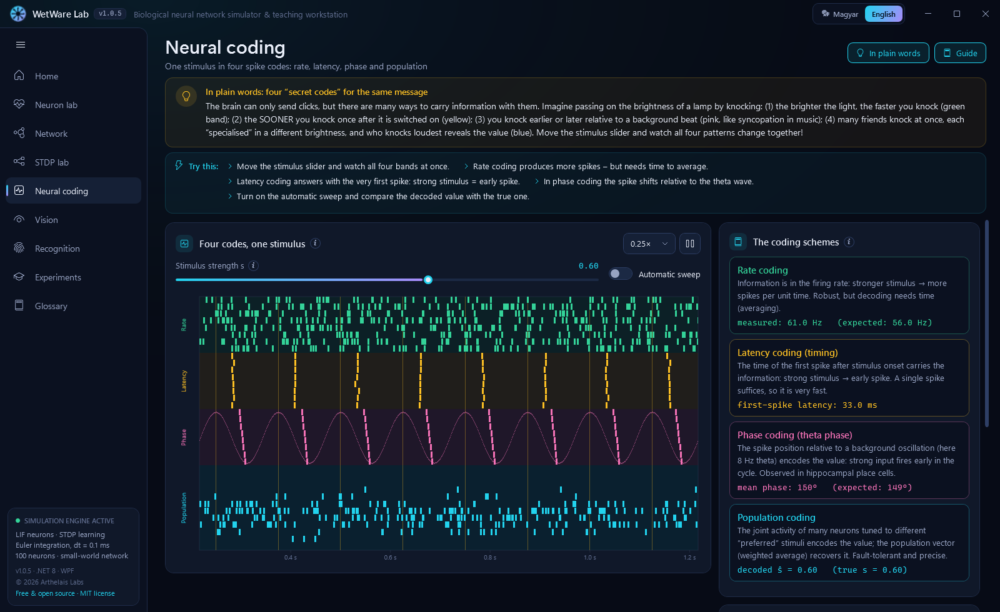
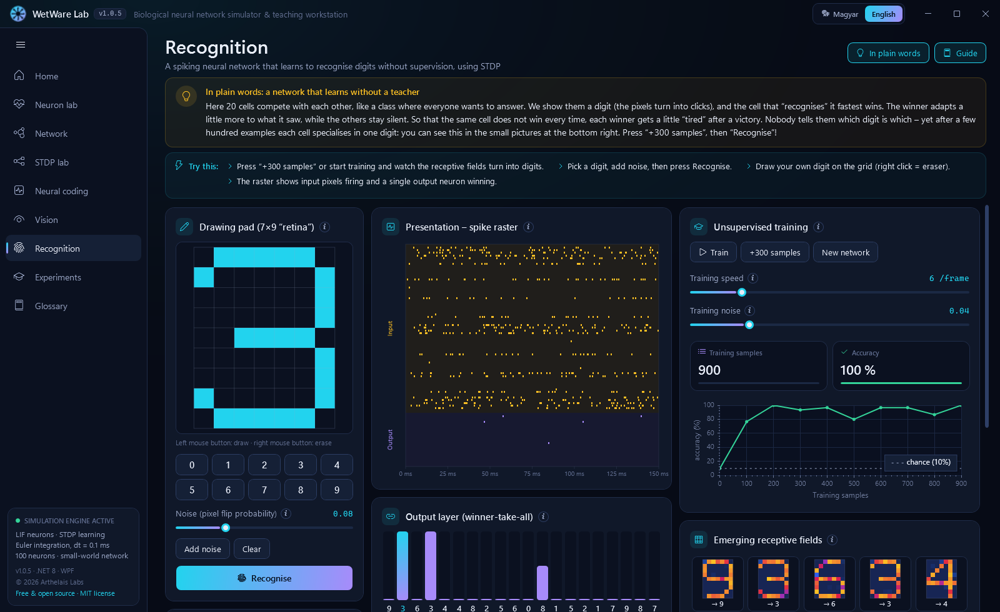
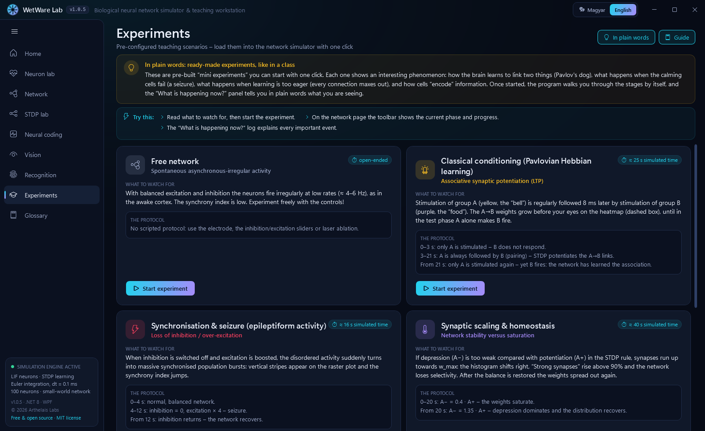
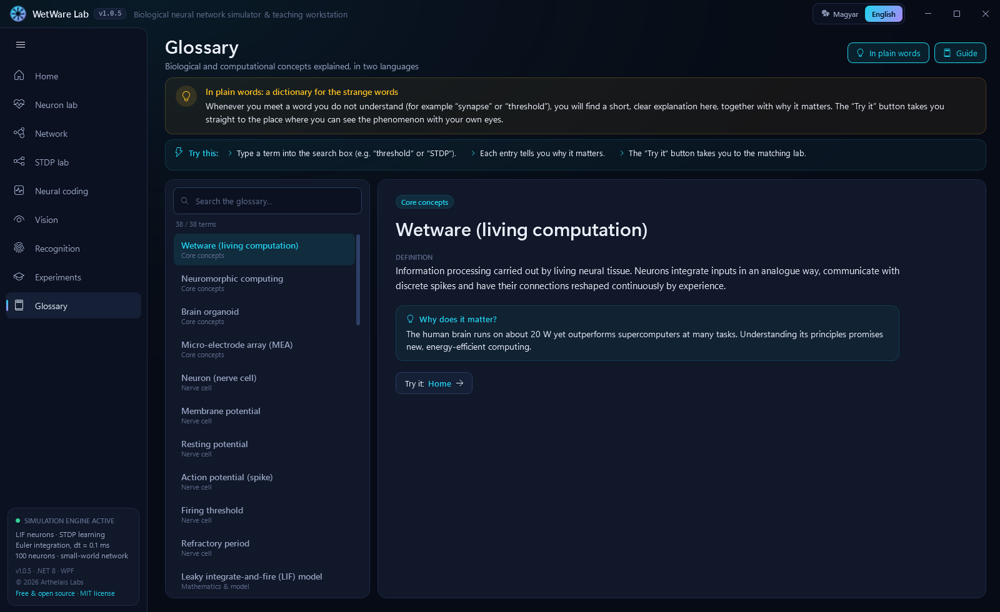

# WetWare Lab – User Guide

**English** · [Magyar](USER_GUIDE.hu.md) · [Back to the README](../README.md)

This guide walks through every page of WetWare Lab: what you see on the screen, what to try, and what it teaches about the brain. No biology background is needed. Each section starts with the everyday explanation that also appears in the app's yellow **"In plain words"** box.

WetWare Lab is free software under the [MIT license](../LICENSE). You may use, copy, share and modify both the program and its source code free of charge, in your own projects or commercially. The only condition is to keep the copyright and license notice.

## Contents

- [Getting started](#getting-started)
- [Home](#home)
- [Neuron lab](#neuron-lab)
- [Network](#network)
- [STDP lab](#stdp-lab)
- [Neural coding](#neural-coding)
- [Vision](#vision)
- [Recognition](#recognition)
- [Experiments](#experiments)
- [Glossary](#glossary)
- [Tips for teachers](#tips-for-teachers)

---

## Getting started

1. Download `WetWareLab.exe` from the [latest release](https://github.com/SandsHUN/WetWareSimulation/releases/latest) and run it. No installation is needed. If Windows SmartScreen warns you, click **More info → Run anyway** (the file is not code-signed).
2. The app starts in English. Use the **Magyar / English** switch in the title bar to change the language at any time; the app remembers your choice.
3. Pick a page in the left-hand menu. The **☰** button collapses the menu into icons.

**Help built into every page**

| Element | What it does |
|---|---|
| **In plain words** (yellow box, top) | An everyday analogy that explains the page without jargon. Toggle it with the *In plain words* button at the top right. |
| **Guide / Try this** (blue box) | Suggested experiments, step by step. Toggle it with the *Guide* button. |
| **ⓘ icons and tooltips** | Hover over any control, chart, variable or number to get an explanation. |
| **What is happening now?** | A live narrator on the Neuron lab and Network pages that explains events as they happen (why a neuron fired, why a synapse got stronger…). |

The bottom of the left menu shows the model in use, the version number, the author and the license. Click the license line to open the source code on GitHub.

---

## Home

> **In plain words:** your brain consists of about 86 billion tiny cells (neurons) that talk to each other with minute electrical "clicks", which we call spikes. A single cell is simple: it collects incoming signals and, once enough have piled up, it clicks too. The magic comes from huge numbers of these cells being connected, and from those connections growing stronger or weaker with experience. That is learning.

**What you see**
- The **animated ring** on the right is a live 100-neuron network running in the background. Every flash is a spike.
- **Module cards** introduce each page. Click *Open* on a card to go there.
- **What is wetware?**, **How to use it** and **The model** briefly explain the background and the exact model parameters.

**Suggested path:** Neuron lab → Network → STDP lab → Experiments. After that, Vision, Recognition and Neural coding can be visited in any order.

---

## Neuron lab

> **In plain words:** a neuron is like a leaky bucket. A tap fills it (the input current), and a small hole lets water leak out all the time. When the water reaches the rim (the threshold), the bucket tips over in an instant (a spike) and starts filling again. A gentle tap never fills it; a strong tap makes it tip often.

**What you see**
- **Examples:** one-click demos. *Silent* (below threshold), *Tonic* (regular firing), *Fast*, *Pulses*, *Noise-driven* and *Leaky*.
- **Electrode & stimulus:** a virtual electrode that injects current into the cell. Choose the stimulus shape (constant, step, pulses, ramp, sine, noisy), its amplitude and the membrane noise.
- **Membrane parameters:** the constants of the model, such as the time constant τm, resting potential, threshold and reset.
- **Oscilloscope:** the membrane voltage over time (top) and the injected current (bottom). The red dashed line is the threshold, the green dotted line the resting potential.
- **Live equation:** the leaky integrate-and-fire equation with the current value under every symbol. Hover over a symbol to see what it means biologically.
- **What is happening now?:** explains in words why the cell is silent or firing.
- **Step-by-step Bio-Debugger:** pause and advance 0.1 ms at a time. It prints each calculation (leak, input, integration step, threshold check).
- **Phase plane** and **f–I curve** (scroll down): how the voltage changes at each voltage level, and how the firing rate depends on the input current.
- **Metric tiles:** measured and theoretical firing rate, rheobase (the smallest current that makes the cell fire), fixed point and capacitance.

**Try this**
1. Click *Silent*. The current is below the rheobase (200 pA), so the voltage settles below the threshold and nothing happens.
2. Drag the amplitude above 200 pA. Spikes appear, and the measured rate matches the theoretical one.
3. Increase τm. The membrane charges more slowly and the firing rate drops.
4. Click *Noise-driven*. The average current is still too weak, yet noise triggers random spikes.
5. Press the pause button, then step with the Bio-Debugger and follow the arithmetic one step at a time.

**What it teaches:** a neuron integrates its input, has a threshold, and needs a short rest (the refractory period) after each spike. The f–I curve is the biological ancestor of the "activation function" in artificial neural networks.

---

## Network

> **In plain words:** 100 "bucket cells" are connected like a group of friends, where everyone passes news to a few neighbours and a few distant acquaintances. 80% of the cells are "encouragers" (excitatory, red) and 20% are "calmers" (inhibitory, blue). In a calm state the dots are scattered. If you remove the calming, everybody starts shouting at once. That is what happens in an epileptic seizure.

**What you see**
- **Toolbar:** scenario picker, pause, *5 ms* step, simulation speed, and the click tools for the graph (*Select*, *Stimulate*, *Laser ablation*). During an experiment it also shows the current phase and a progress bar.
- **Real-time metrics:**
  - *Synchrony* χ: about 0.1–0.2 is the healthy, asynchronous state; above 0.4 the network fires together, as in a seizure.
  - *Mean firing rate*, *Strong synapses*, *Mean weight*, *Total spikes*, *Ablated*.
- **Spike raster plot:** every row is a neuron and every dot a spike. Vertical stripes mean the neurons fire together. The population firing rate is plotted underneath. Click a row to select that neuron.
- **Network topology:** the neurons on a ring. Short arcs connect neighbours and long chords are random shortcuts. Firing cells flash, and the yellow dots are spikes travelling along the selected neuron's connections.
- **Stimulation & control panel:** electrode current, inhibition and excitation strength, background noise, STDP learning on/off, learning rate and the LTD/LTP ratio.
- **Selected neuron:** oscilloscope of the chosen cell.
- **STDP weight matrix** (heatmap) and **weight distribution** (histogram): how strong each connection is, and how the strengths are distributed.
- **Interactive maths & theory lab:** tabs for the live formulas, the STDP learning curve with real events, the phase space and the Bio-Debugger.
- **What is happening now?:** a running log that explains each event, for example: *"Because neuron 12 fired 4 ms before neuron 31, the synapse grew by +0.008 (LTP)."*

**Try this**
1. Click a neuron on the graph. The oscilloscope and the equations follow it.
2. Choose the *Stimulate* tool, click a few neurons, then switch on the electrode and watch them fire.
3. Drag *Inhibition strength* to 0 and raise *Excitation strength*. Vertical stripes appear and χ jumps.
4. With *Laser ablation*, switch off a group of neurons and watch how the rest of the network carries on.
5. Load *Synchronisation & seizure* from the scenario list and let it run through its three phases.

**What it teaches:** brain function depends on a balance between excitation and inhibition. Losing inhibition leads to synchronous, seizure-like activity, which is why many antiepileptic drugs work by boosting inhibition.

---

## STDP lab

> **In plain words:** "cells that fire together wire together". Think of Pavlov's dog: if the bell always rings just before the food arrives, the dog learns that the bell means food. Connections between cells learn the same way. If cell A regularly fires just before cell B, the A→B connection grows stronger. If the order is reversed, it weakens.

**What you see**
- **Examples:** *Causal (pre → post)*, *Reversed (post → pre)*, *Distant (45 ms)* and *Random timing*.
- **Pairing protocol:** the time difference Δt between the two spikes, timing jitter, pairing rate, and buttons to run pairings continuously or one at a time. This follows the classic Bi & Poo (1998) experiment.
- **Learning rule parameters:** A+, A−, τ+ and τ−, the four numbers that shape the learning window.
- **STDP learning window:** how much the weight changes as a function of Δt. The green branch is strengthening (LTP), the yellow branch weakening (LTD). Each completed pairing appears as a dot.
- **Evolution of the synaptic weight:** the weight after each pairing.
- **Pairing live:** an animation of the two spikes. The circle on the right is the synapse, and its size follows the weight.
- **Biological background:** the role of the NMDA receptor and Hebb's original 1949 quote.

**Try this**
1. Run *Causal*. The weight grows step by step.
2. Switch to *Reversed*. The weight shrinks.
3. Set Δt to 45 ms. Almost nothing happens, because the learning window fades exponentially with time.
4. Try *Random timing*. The overall direction depends on whether the A+ or the A− side of the window is larger.

**What it teaches:** the timing of spikes, down to milliseconds, decides whether a connection strengthens or weakens. This is one of the main mechanisms of learning and memory.

---

## Neural coding

> **In plain words:** the brain can only send clicks, but there are many ways to carry information with them. Imagine passing on the brightness of a lamp by knocking: (1) the brighter the light, the faster you knock; (2) the brighter it is, the sooner you knock once after it switches on; (3) you knock earlier or later relative to a steady background beat; (4) many friends knock together, each "specialised" in one brightness.

**What you see**
- **Stimulus strength s** slider (0–1) and *Automatic sweep*, which moves the stimulus slowly up and down.
- **Four codes, one stimulus:** four bands showing the same value encoded four ways:
  - *Rate* (green): stronger stimulus, more spikes.
  - *Latency* (yellow): stronger stimulus, earlier first spike.
  - *Phase* (pink): the spike's position within an 8 Hz background wave.
  - *Population* (blue): 12 neurons, each preferring a different value.
- **The coding schemes:** a card for each code with a live readout, for example the measured versus expected rate, or the decoded versus true value.
- **Tuning curves & population response:** how the 12 population neurons respond, and how the value is read back from them.
- **Comparison table:** speed, noise robustness, energy cost and where each code appears in the brain.

**Try this**
1. Move the slider slowly and watch all four bands change together.
2. Note that the latency code answers with a single spike, while the rate code needs time to count spikes.
3. Switch on *Automatic sweep* and compare the decoded population value with the true one.

---

## Vision

> **In plain words:** your eye does not take photos, it draws outlines. Retinal cells signal when a spot is brighter or darker than its surroundings, so they send mostly edges to the brain, like a sketch. That is why you see grey dots at the crossings of a white grid even though nothing is there.

**What you see.** Six numbered panels follow the visual pathway:
1. **Photoreceptors:** the input image. Click it to move the profile line, or draw on it in drawing mode.
2. **ON-centre cells:** fire where the centre is brighter than its surroundings.
3. **OFF-centre cells:** fire where it is darker.
4. **Centre–surround response:** only the edges remain; uniform areas disappear.
5. **V1 orientation map:** the primary visual cortex. Colour shows the direction of each edge (0°, 45°, 90°, 135°).
6. **Ganglion-cell spikes:** the image as it travels along the optic nerve, as spikes.

The left side has the **Visual stimulus** picker. It includes the illusions *Hermann grid*, *Mach bands* and *Simultaneous contrast*, plus gratings, a face and a noisy square. You can draw on the input or load your own photo. Further down are the **receptive-field** sliders and presets (*Strong inhibition*, *No inhibition*, *Large receptive field*), the **filter kernels** and the **intensity profile**.

**Try this**
1. Look at the *Hermann grid*. On panel 2, the response is weaker at the crossings. That is where the grey dots come from.
2. Choose *Mach bands* and click the image. The profile shows a small overshoot at every step.
3. Press *No inhibition*. The illusions and the edge enhancement disappear.
4. Choose *Oriented bar* and rotate it. The colour of the V1 map follows the angle.
5. Load a photo of your own and see what the retina sends to the brain.

**What it teaches:** perception starts with computation. The retina compresses the image into contrast, and V1 detects edge orientation (Hubel & Wiesel, Nobel Prize 1981).

---

## Recognition

> **In plain words:** a network that learns without a teacher. 20 cells compete, like a class where everyone wants to answer. The cell that recognises a digit fastest wins and adapts a little more to it. Nobody tells them which digit is which, yet after a few hundred examples each cell specialises in one digit.

**What you see**
- **Drawing pad (7×9 "retina"):** every square is an input neuron. Draw with the left mouse button and erase with the right. Below it are digit templates 0–9, a noise slider, *Add noise*, *Clear* and *Recognise*.
- **Unsupervised training:** *Train* (continuous), *+300 samples* (instant), *New network*, training speed and training noise. Next to them are the *Training samples* and *Accuracy* counters, and an accuracy curve. Random guessing would score 10%.
- **Presentation – spike raster:** input pixels firing (yellow) and output neurons competing (purple).
- **Output layer (winner-take-all):** spike counts of the 20 output neurons, each with the digit it learned.
- **Emerging receptive fields:** what each output neuron has learned, drawn as a small image. Random noise slowly turns into digit shapes.
- **Result** and **How does it work?**: the recognised digit with its confidence, and the five-step explanation (encoding, integration, competition, learning, homeostasis).

**Try this**
1. Press *+300 samples* two or three times and watch the receptive fields turn into digits and the accuracy climb.
2. Click a digit, press *Add noise*, then *Recognise*. The network usually still gets it right.
3. Draw your own digit on the pad and test it.
4. Press *New network* to start again from random weights.

**What it teaches:** spike-timing learning (STDP), competition through inhibition, and self-adjusting thresholds are enough for a network to discover categories without any labels (Diehl & Cook, 2015).

---

## Experiments

> **In plain words:** ready-made mini experiments, like in a class. Each one shows an interesting phenomenon with one click. The program walks you through the stages, and the "What is happening now?" panel explains what you are seeing.

Each card describes the phenomenon, **what to watch for** and **the protocol** (the timeline). *Start experiment* loads it on the Network page.

| Experiment | What happens |
|---|---|
| **Free network** | Balanced, irregular activity at about 4–6 Hz, like an awake cortex. Experiment freely with the controls. |
| **Classical conditioning (Pavlov)** | 0–3 s: only group A (the "bell") is stimulated, and B does not respond. 3–21 s: A is always followed by B, so STDP strengthens the A→B synapses. From 21 s: A alone now makes B fire. The network has learned the association. |
| **Synchronisation & seizure** | 0–4 s: normal network. 4–12 s: inhibition is switched off and excitation boosted, so synchronous bursts appear. From 12 s: inhibition returns and the network recovers. |
| **Synaptic scaling & homeostasis** | 0–20 s: learning is too eager and every synapse saturates. From 20 s: the balance is restored and the weight distribution recovers. |
| **Information coding modes** | One group shows rate coding and another phase coding, side by side on the raster plot. |

---

## Glossary

> **In plain words:** a dictionary for the strange words. Whenever you meet a word like "synapse" or "threshold", you will find a short, clear explanation here, together with why it matters.

- 38 terms in both languages, with a search box at the top.
- Each entry gives a definition and why the concept matters.
- The **Try it:** link takes you to the page where you can see the phenomenon yourself.

---

## Tips for teachers

- **A 45-minute lesson:** Home (5 min) → Neuron lab, leaky bucket and threshold (10 min) → Network, balance and seizure (10 min) → Experiments: Pavlov (10 min) → Recognition (10 min).
- Switch the yellow **In plain words** boxes on for beginners and off for advanced students.
- Use **pause** and the **Bio-Debugger** to go through the arithmetic together on a projector.
- The language can be switched in the middle of a lesson, which is handy in bilingual classes.
- Because the app is MIT-licensed, you may copy it to every computer in the classroom, share it with students, translate it or adapt the source code for your own course.
